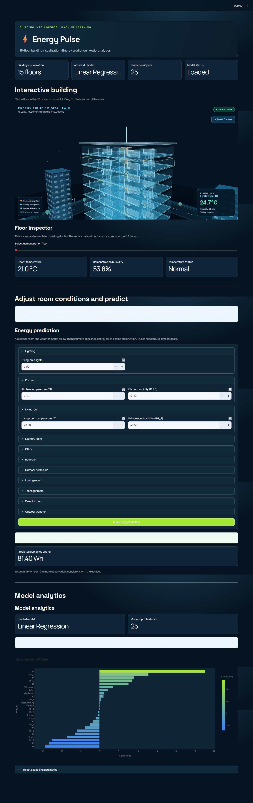

# ⚡ Energy Pulse

### Smart Energy Consumption Prediction & 3D Smart-Building Digital Twin

Energy Pulse is a machine-learning project that estimates residential appliance energy consumption from environmental measurements and presents the project through an interactive Streamlit dashboard. The dashboard includes a holographic 15-floor building and a decorative smart-city environment to make the system easier to explore.

> **Important:** The trained model uses the UCI Appliances Energy Prediction residential dataset. The 15-floor building, surrounding buildings, roads, cars, trees, and floor-level demonstration values are visual simulations. They are not connected to real campus sensors, smart meters, or live city data.

---

## Dashboard Showcase

The combined project showcase below presents the dashboard, 3D smart-city environment, energy prediction interface, and model analytics.



---

## Features

- **Energy prediction:** Estimate appliance energy consumption for the supplied observation using the saved model.
- **Interactive 15-floor building:** Explore a 3D holographic building and inspect individual floors.
- **Smart-city environment:** Decorative neighbouring buildings, roads, lane markings, crosswalks, sidewalks, streetlights, trees, and vehicles.
- **Room-oriented inputs:** Present environmental variables with room labels while retaining the original feature keys expected by the trained model.
- **Model analytics:** Inspect the selected model and its input features and supported value ranges.
- **Dark dashboard interface:** High-contrast styling and a consistent visual theme.

## Machine Learning

The project is a supervised regression task.

- **Target:** `Appliances` — appliance energy consumption in watt-hours (Wh) for the dataset observation interval.
- **Dataset:** UCI Appliances Energy Prediction.
- **Input:** 25 selected environmental and building-measurement features.
- **Saved model:** Loaded from `energy_pulse_model.pkl`.
- **Algorithms explored:** Linear Regression and Random Forest Regression.

The application uses the model stored in the repository. It does not retrain the model when the dashboard starts.

### Prediction interpretation

The application estimates energy consumption for the input observation. It is **not** a future-time energy-demand forecast.

## Dataset

The UCI Appliances Energy Prediction dataset contains measurements from a residential building:

- 19,735 observations.
- 29 original columns.
- Target variable: `Appliances`.
- 25 selected input features used by this project.

The dataset is residential, not campus-wide or floor-level sensor data. Room/floor labels in the dashboard are a presentation layer for the existing model inputs; they do not turn the original dataset into real floor measurements.

## Technology Stack

| Technology | Purpose |
|---|---|
| Python | Application and model integration |
| Streamlit | Interactive web dashboard |
| scikit-learn | Machine-learning algorithms |
| Pandas | Input data handling |
| NumPy | Numerical operations |
| Joblib | Loading the saved model |
| Plotly | Interactive charts, where used |
| Three.js | 3D building and city visualization |

## Project Structure

```text
Energy-Pulse/
├── app.py
├── energy_pulse_model.pkl
├── requirements.txt
├── README.md
├── .gitignore
├── docs/
│   ├── architecture.md
│   ├── machine_learning.md
│   └── limitations.md
└── screenshots/
    ├── overview.png
    ├── smart_city.png
    ├── energy_prediction.png
    └── model_analytics.png
```

The `docs/` and `screenshots/` folders can be added as project documentation and screenshots are prepared.

## Installation (Windows PowerShell)

### 1. Clone the repository

```powershell
git clone https://github.com/Saura8h01/Energy-Pulse.git
cd Energy-Pulse
```

### 2. Create and activate a virtual environment

```powershell
python -m venv .venv
.\.venv\Scripts\Activate.ps1
```

If PowerShell blocks activation, use:

```powershell
Set-ExecutionPolicy -Scope Process -ExecutionPolicy Bypass
.\.venv\Scripts\Activate.ps1
```

### 3. Install dependencies

```powershell
python -m pip install -r requirements.txt
```

### 4. Run the application

```powershell
python -m streamlit run app.py
```

Open `http://localhost:8501` in your browser.

## Model File

The application expects this file in the project root:

```text
energy_pulse_model.pkl
```

This is the saved model bundle used by the application. Keep the file in the same directory as `app.py`. Do not rename or replace it unless the application is deliberately updated to load a different model bundle.

## Evaluation

The project can be evaluated using regression metrics such as:

- **MAE:** Mean Absolute Error.
- **RMSE:** Root Mean Squared Error.
- **R²:** Coefficient of Determination.

Only report numerical metric values when they have been verified against the actual model evaluation output. The dashboard does not invent or assume metric values if they are not present in the saved model bundle.

## Limitations

- The source dataset represents one residential building, not a university campus or a real 15-floor building.
- The city and floor visualizations are simulated decorative elements.
- No live IoT sensors, smart meters, HVAC controls, or traffic feeds are connected.
- The prediction estimates the supplied observation; it does not forecast future energy demand.
- Prediction reliability depends on the original dataset, feature preparation, and the range and quality of user inputs.

## Future Improvements

- Integrate real smart-meter or IoT sensor data.
- Add a separately trained time-series forecasting model for future demand.
- Store and visualize historical prediction results.
- Add model evaluation reports based on reproducible test data.
- Deploy the dashboard for remote access.

## Author

**Saura8h01**

GitHub: [https://github.com/Saura8h01](https://github.com/Saura8h01)

Repository: [https://github.com/Saura8h01/Energy-Pulse](https://github.com/Saura8h01/Energy-Pulse)
